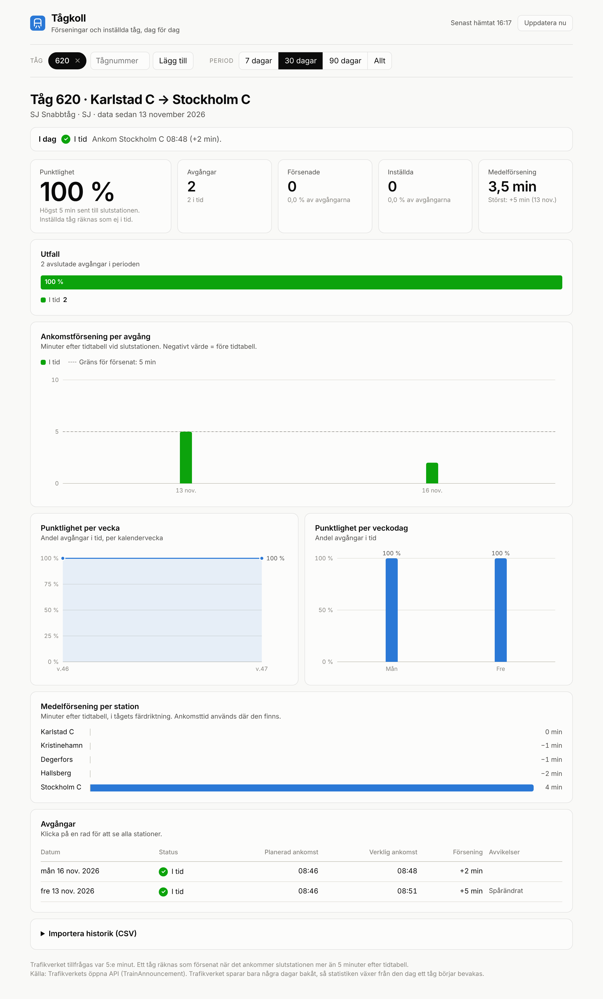

# Tågkoll

En liten webbapp som samlar in förseningar och inställda tåg från Trafikverkets öppna API
och visar statistiken i en dashboard. Bevakar tåg 620 (Karlstad C → Stockholm C) från start;
fler tågnummer läggs till och tas bort direkt i gränssnittet.



## Kom igång

```bash
cp .env.example .env        # fyll i TRAFIKVERKET_API_KEY
docker compose up -d --build
```

Öppna sedan `http://<värd>:8843`. Databasen (SQLite) ligger i Docker-volymen `tagkoll-data`
och överlever omstarter och ombyggen.

## Så fungerar det

- En bakgrundstråd frågar Trafikverket (`TrainAnnouncement`) var 5:e minut och sparar varje
  hållplatsläge i SQLite. Trafikverket behåller bara några dagar bakåt, så statistiken byggs upp
  från den dag ett tåg börjar bevakas.
- Ett tåg räknas som **försenat** när det ankommer slutstationen mer än 5 minuter efter tidtabell
  (samma gräns som det officiella punktlighetsmåttet). Inställda och delvis inställda avgångar
  räknas som ej i tid.
- Äldre historik kan läggas in under *Importera historik (CSV)*, en rad per dag:
  `datum;försening_min;inställt`. Importerade dagar används bara där egna data saknas.

## Inställningar (`.env`)

| Variabel | Standard | Betydelse |
|---|---|---|
| `TRAFIKVERKET_API_KEY` | – | API-nyckel, krävs |
| `PORT` | `8843` | Port på värden |
| `INITIAL_TRAINS` | `620` | Tåg som bevakas vid allra första start |
| `POLL_INTERVAL_SECONDS` | `300` | Hur ofta Trafikverket tillfrågas |
| `DELAY_THRESHOLD_MIN` | `5` | Gräns för "försenat", i minuter |

Appen har ingen inloggning – kör den bara på ett nät du litar på.
